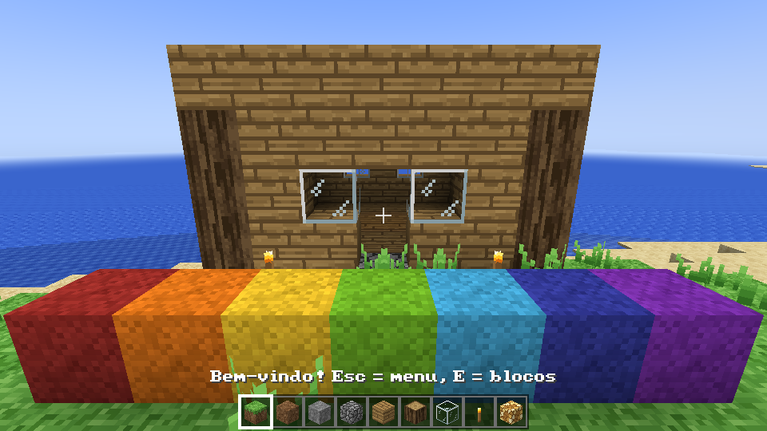

# Mine Clone

A Minecraft-like block game written in **Rust**, built for speed. Rendering uses **wgpu** on
Vulkan (Windows/Linux), Metal (macOS) or DirectX 12. No Java, no Mojang code, art or music:
everything here is original, and the design comes from public descriptions of the game.

> **Português:** veja [docs/COMO-JOGAR.txt](docs/COMO-JOGAR.txt) para controles e como usar suas
> músicas e pacotes de textura, e [docs/plan/RESUMO.md](docs/plan/RESUMO.md) para o plano completo.



## Download

Every push builds the game for Windows, Linux and macOS in GitHub Actions
(**Actions → build → Artifacts**). Unzip and run `mine-clone`. Pushing a tag like `v0.1.0`
publishes the same files as a GitHub Release.

## Build from source

```sh
# Linux needs: libasound2-dev libxkbcommon-dev libudev-dev
cargo run --release -p game
```

## What works (phases 0 and 1 of the [roadmap](docs/plan/roadmap.md), plus the start of phase 2)

- Infinite world with biomes (plains, forest, birch forest, taiga, snowy plains, desert, beach,
  ocean, mountains), caves, lava lakes, ores (coal, copper, tin, iron, silver, gold, redstone,
  lapis, diamond, emerald), trees, flowers, cactus, pumpkins and melons.
- Creative mode: walk, sprint, sneak (no falling off edges), fly, swim; break, place and pick
  blocks; inventory with every block; falling sand and gravel.
- Sky light and block light (torches, glowstone, lava) with smooth lighting and ambient occlusion.
- Day/night cycle with a square sun and moon, stars, sunsets and drifting blocky clouds; fog;
  underwater fog.
- Worlds save automatically (only edited chunks are stored, compressed with LZ4).
- Classic music system: rare, calm tracks with long silences, 7 original tracks, plus your own
  music folder (only yours, only the game's, or both). Procedural block sounds and footsteps.
- Resource packs, including Minecraft texture packs of any resolution, switchable in-game.
- Shader packs (Esc > Shaders): built-in "Realçado" (bloom, sun rays, colour grading,
  vignette, distance haze, waving plants, rippling water) and "Suave", plus your own WGSL
  post-processing packs in `shaderpacks/` (see the generated `LEIA-ME.txt` and
  `shaderpacks-examples/sepia`).
- Block depth (Esc > Shaders > Profundidade): parallax occlusion mapping with heights read from
  each texture, walked texel by texel so pixel art gets crisp carved columns; near the camera
  and on the "Bonito" quality only.
- Distant terrain (LOD): a low-detail heightmap from the world generator drawn 256–1024
  blocks past the render distance, built on worker threads.
- Debug screen (F3), screenshots (F2), crash log, settings file.
- Mobs from `packs/vanilla/mobs.ron`: pig, cow, sheep, chicken, zombie, skeleton, stalker (our
  own exploding mob) and spider, with box models, walk animations and skin layers that stand off
  the body as real 3D relief. Animals spawn on grass in the light, monsters in the dark.
- Survival mode (toggle in the pause menu): health, fall, lava and drowning damage, mob attacks,
  explosions, death and respawn.
- Game controllers: DualShock 4 and DualSense read directly over USB/Bluetooth HID (touchpad,
  gyro aiming, light bar, rumble), other pads through gilrs; full button remapping in-game.
- 3D clouds (ray-marched, idea from Better Clouds), bigger sun and moon.
- Paintings: 16 original pictures plus your own PNGs in `paintings/`; aim at a wall and press P.

## Layout

| Path | What |
|---|---|
| `crates/voxel` | World core with no GPU code: block registry, paletted chunks, world generation, lighting, meshing, physics, ray casting, saves. Fully unit tested. |
| `crates/game` | The game: window, renderer and shaders, chunk streaming on worker threads, HUD and menus, audio. |
| `packs/vanilla` | The base game as a data pack: `blocks.ron`, `mobs.ron`, `paintings.ron`, 16×16 block textures, 64×128 mob skins and paintings. Mods use the same format. |
| `assets/music` | Original music (generated by `tools/compose_music.py`). |
| `tools/` | Texture and music generators. |
| `docs/plan` | Full design: inventory of Minecraft content, architecture, roadmap, mods, magic/RPG and Terraria ideas. |

## Performance notes

- Chunks are generated, lit and meshed on all CPU cores; the main thread only uploads results.
- Sections are stored with palettes (an empty section costs a few bytes).
- Faces between solid blocks are never built; vertices are packed into 12 bytes.
- Sections outside the view frustum are skipped; opaque geometry is drawn front to back.
- `cargo run --release -p voxel --example bench` times generation, lighting and meshing.
